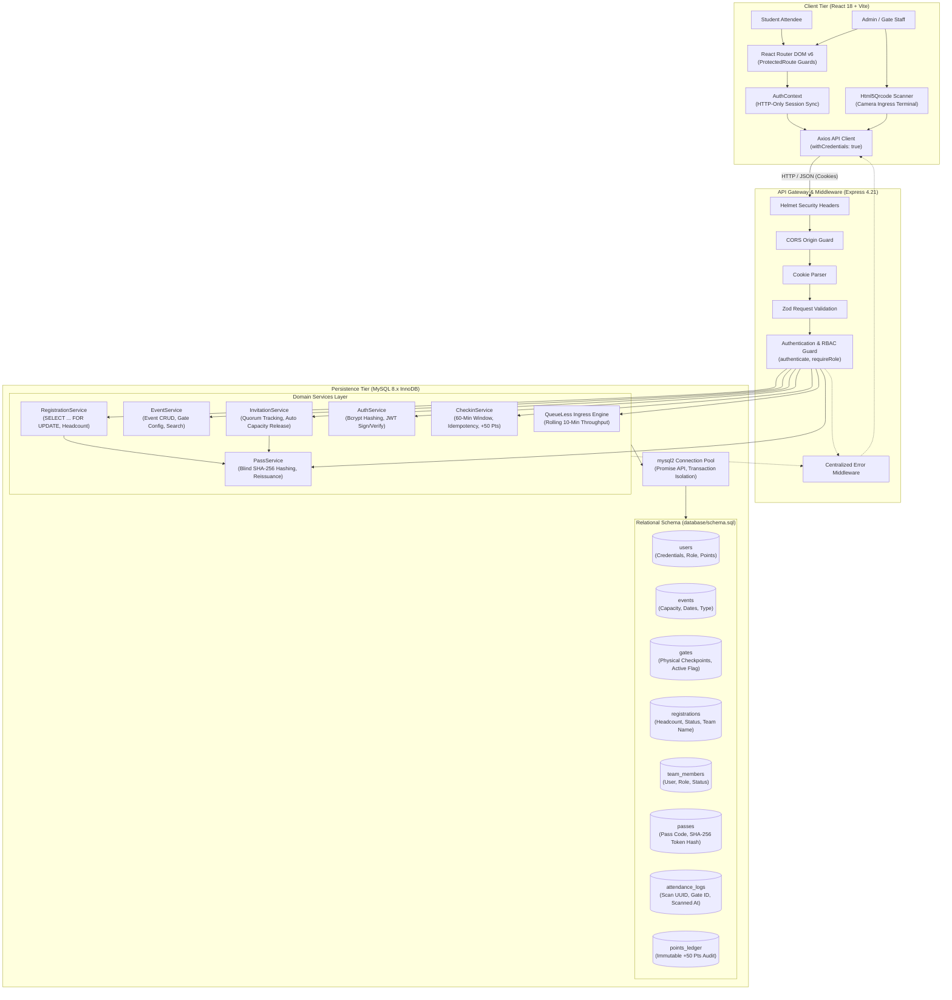
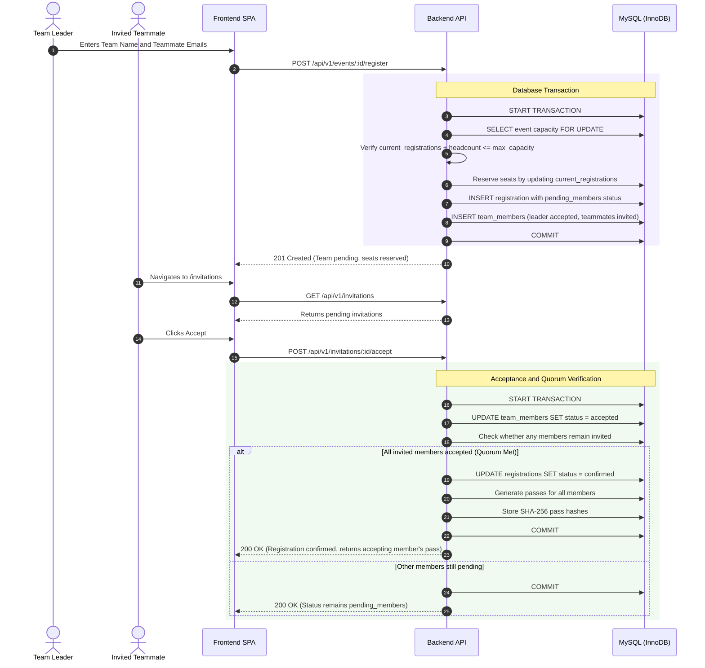
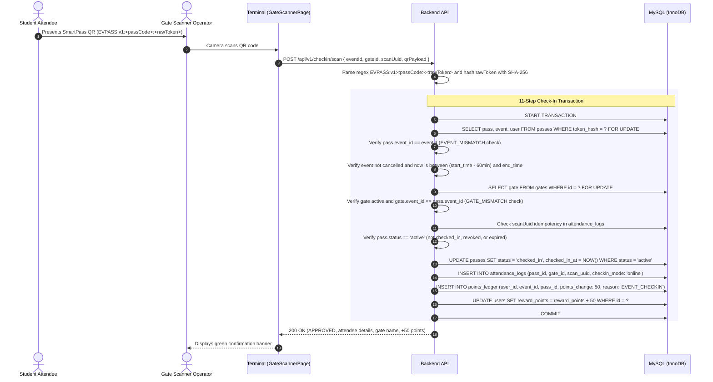

# EventHub

> **Intelligent Campus Event Management Ecosystem**  
> A high-concurrency event lifecycle, multi-gate ingress scanning, and gamified campus participation platform.

[](https://nodejs.org/)
[](https://expressjs.com/)
[](https://react.dev/)
[](https://vitejs.dev/)
[](https://tailwindcss.com/)
[](https://www.mysql.com/)
[](#14-testing-and-verification-results)

---

## Table of Contents

1. [Project Overview](#1-project-overview)
2. [Problem Statement](#2-problem-statement)
3. [Our Solution & Key Differentiators](#3-our-solution--key-differentiators)
4. [Main Features](#4-main-features)
   - [Student Capabilities](#student-capabilities)
   - [Administrator & Gate Staff Capabilities](#administrator--gate-staff-capabilities)
   - [System & Architecture Capabilities](#system--architecture-capabilities)
5. [Technology Stack](#5-technology-stack)
6. [System Architecture](#6-system-architecture)
7. [Main User Workflows](#7-main-user-workflows)
   - [Team Registration & Headcount Workflow](#team-registration--headcount-workflow)
   - [SmartPass Issuance & Gate Check-In Workflow](#smartpass-issuance--gate-check-in-workflow)
8. [Database Overview](#8-database-overview)
9. [Repository Structure](#9-repository-structure)
10. [Local Installation & Setup](#10-local-installation--setup)
11. [Environment Configuration](#11-environment-configuration)
12. [API Reference Overview](#12-api-reference-overview)
13. [Screenshots](#13-screenshots)
14. [Testing and Verification Results](#14-testing-and-verification-results)
15. [Security & Concurrency Design](#15-security--concurrency-design)
16. [Future Scope](#16-future-scope)
17. [Contribution & Project Information](#17-contribution--project-information)

---

## 1. Project Overview

**EventHub** is a web-based campus event management platform designed specifically for university environments. Built with a decoupled client-server architecture consisting of a React 18 Single-Page Application (SPA) and an Express 4 RESTful API backed by MySQL 8 InnoDB, EventHub manages campus event operations:

- **Structured Discovery**: Students can search, filter by category, and view real-time available capacity for academic workshops, technical competitions, hackathons, and cultural events.
- **Concurrency-Controlled Registrations**: Pessimistic database row locks prevent overbooking during high-traffic registration periods for both individual students and multi-member teams.
- **Cryptographically Hashed Admission Tokens**: Dynamic SmartPass QR tokens store only one-way SHA-256 hashes on the server. The raw 32-byte secret is issued solely to the attendee, protecting database credentials from generating unauthorized passes. If a pass is compromised, the student can reissue it to invalidate prior tokens.
- **Multi-Gate Ingress Scanning**: Camera-based QR check-in terminals validate admissions in real time, enforce arrival windows, prevent replay attacks via idempotent scan UUIDs, and record attendance logs.
- **Throughput Analytics**: The QueueLess engine aggregates rolling 10-minute check-in scan velocities across active gates to help staff and attendees monitor flow rates.
- **Campus Rewards**: Verified gate admissions automatically credit reward points to attendees' profiles via an immutable database points ledger.

---

## 2. Problem Statement

Campus event organizers and student bodies frequently face operational challenges:

1. **Ticket Duplication & Uncontrolled Sharing**: Campus events that distribute static PDF tickets or plain QR codes encoding raw student IDs are vulnerable to unauthorized sharing and screenshot passing.
2. **Registration Race Conditions & Overbooking**: Popular events with limited capacity experience concurrent registration bursts. Without database-level concurrency control, concurrent requests can exceed venue seating limits.
3. **Uncoordinated Team Registrations**: Hackathons and group competitions require multi-member teams. Conventional forms often rely on manual text entry of teammates or uncoordinated individual signups, resulting in partial teams stranded when event capacity is reached.
4. **Physical Gate Congestion**: Entry checkpoints relying on manual paper lists or slow verification create long queues at main entrances while alternative gates remain underutilized.
5. **Lack of Ingress Telemetry**: Event staff often lack live data on check-in velocity across gates, making it difficult to balance attendee flow.
6. **Absence of Verifiable Attendance Rewards**: Institutions lack an automated, auditable mechanism to reward verified event participation with campus reward points.

---

## 3. Our Solution & Key Differentiators

EventHub addresses these challenges through a coordinated architectural approach:

| Operational Area | Conventional Approach | EventHub Implementation |
|---|---|---|
| **Pass Storage Security** | Static QR codes or PDFs storing raw IDs or sequential ticket numbers. | **One-Way Token Hashing**: Server stores only a SHA-256 digest of a 32-byte cryptographically random token. The raw token is returned only in the QR payload (`EVPASS:v1:...`). |
| **Pass Reissuance & Screenshots** | Static passes cannot be invalidated without deleting the registration. | **Cryptographic Hash Rotation**: Students can reissue compromised passes, rotating the stored hash and invalidating previous tokens. *(Note: A screenshot of an active, unrevoked QR token remains valid until scanned or reissued).* |
| **Capacity Management** | Application-level counter increments prone to race conditions under load. | **Pessimistic Row Locking (`SELECT ... FOR UPDATE`)**: Atomically verifies and reserves capacity within explicit database transactions. |
| **Team Coordination** | Uncoordinated individual registrations or unstructured text entries. | **Headcount Reservation & Invitation Engine**: Team leader reserves full team headcount upfront. Teammates accept via their invitation inbox. If members decline and drop the team below the minimum team size, the reservation cancels and capacity is released automatically. |
| **Physical Check-In** | Manual name lookup or unverified check-in lists. | **Webcam Gate Scanner (`html5-qrcode`)**: Validates QR payloads, verifies event/gate matching, enforces a 60-minute pre-event check-in window, and blocks duplicate scans. |
| **Scan Idempotency** | Network retries can double-count attendance or trigger duplicate errors. | **UUID-Based Idempotency**: Each scan carries a client-generated UUID (`scanUuid`). Repeated submissions of the same scan return the original approved result without double-counting. |
| **Ingress Telemetry** | No visibility into arrival rates across distinct entrance doors. | **QueueLess Ingress Engine**: Aggregates check-in throughput over a rolling 10-minute window, providing color-coded flow indicators and gate recommendations. |
| **Participation Rewards** | Disconnected attendance records with no incentive structure. | **Points Ledger**: Atomically credits +50 reward points per verified check-in, guarded by a unique constraint (`uq_pass_reason`) preventing duplicate credits. |

---

## 4. Main Features

### Student Capabilities
- **Explore & Filter**: Discover campus events with keyword search across titles, descriptions, and venues, paired with category filtering and pagination.
- **Individual & Team Registration**: Register individually or submit a team registration specifying team name and teammate emails.
- **Team Invitation Inbox**: View incoming team invitations with inviter and event details; accept or decline invitations directly from the portal.
- **Navigation Invitation Indicator**: The navigation bar checks for pending invitations upon route navigation and displays a count badge when unhandled invitations exist.
- **SmartPass Wallet**: View issued passes under `/my-passes`, rendering dynamic QR codes (`EVPASS:v1:<passCode>:<rawToken>`).
- **Pass Reissuance**: Invalidate a compromised pass and generate a fresh token with an atomically rotated hash.
- **Profile & Rewards**: View student profile details, academic department, campus ID, and accumulated reward points.

### Administrator & Gate Staff Capabilities
- **Event Lifecycle Management**: Create, edit, publish, and cancel events. Configure registration types (`individual` or `team`), team size limits (`min_team_size` to `max_team_size`), venues, dates, and capacities.
- **Multi-Gate Configuration**: Add and manage physical entrance gates per event with location descriptions and active toggles.
- **Camera-Based Gate Scanner**: Scan attendee QR codes via webcam using `html5-qrcode`, with immediate visual confirmation and a manual text fallback for unreadable screens.
- **QueueLess Throughput Monitor**: Inspect rolling 10-minute check-in velocities across active gates to identify bottlenecks and view recommended gates.
- **Event Cancellation**: Safely cancel events while retaining historical data and automatically revoking associated active passes.

### System & Architecture Capabilities
- **Role-Based Access Control (RBAC)**: Enforces role separation (`student` vs. `admin`) across backend middleware and client route guards (`ProtectedRoute`).
- **Check-In Window Validation**: Restricts check-in to an authorized window (from 60 minutes prior to event start until event conclusion).
- **Scan Idempotency**: Guards attendance and point credits using unique scan UUIDs.
- **Standardized API Error Envelopes**: Consistent error responses with semantic machine-readable error codes (`CAPACITY_FULL`, `WINDOW_CLOSED`, `GATE_MISMATCH`, `DUPLICATE_CHECKIN`).

---

## 5. Technology Stack

### Frontend Client
- **Framework**: [React 18.3.1](https://react.dev/) (Component-based Single-Page Application)
- **Build Tool**: [Vite 6.0.3](https://vitejs.dev/) (Local development server and Rollup production bundler)
- **Styling**: [Tailwind CSS 3.4.16](https://tailwindcss.com/) (Custom purple campus aesthetic)
- **Routing**: [React Router DOM 6.28.0](https://reactrouter.com/) (Declarative routing with role-based `ProtectedRoute` guards)
- **HTTP Client**: [Axios 1.7.9](https://axios-http.com/) (Configured with credentials and standardized error extraction)
- **QR Scanner**: [HTML5-QRCode 2.3.8](https://github.com/mebjas/html5-qrcode) (Camera feed processing and QR decoding)
- **Iconography**: [Lucide React 0.468.0](https://lucide.dev/) (Interface icons)

### Backend API Server
- **Runtime**: [Node.js 18+](https://nodejs.org/) (Native ES Modules)
- **Framework**: [Express 4.21.2](https://expressjs.com/) (RESTful routing and middleware composition)
- **Database Driver**: [MySQL2 3.12.0](https://github.com/sidorares/node-mysql2) (Connection pool with Promise API)
- **Schema Validation**: [Zod 3.24.2](https://zod.dev/) (Runtime validation of request bodies and query parameters)
- **Security & Utilities**:
  - [BcryptJS 2.4.3](https://github.com/dcodeIO/bcrypt.js) (Password hashing with 12 salt rounds)
  - [JsonWebToken 9.0.2](https://github.com/auth0/node-jsonwebtoken) (Signed JWT session bearer tokens)
  - [Cookie-Parser 1.4.7](https://github.com/expressjs/cookie-parser) (Parsing HTTP-only session cookies)
  - [Helmet 8.0.0](https://helmetjs.github.io/) (HTTP security headers)
  - [CORS 2.8.5](https://github.com/expressjs/cors) (Origin whitelisting with credential support)
  - [QRCode 1.5.4](https://github.com/soldair/node-qrcode) (Server-side dynamic QR code Data URL generation)
  - [Dotenv 16.4.7](https://github.com/motdotla/dotenv) (Environment variable loading)

### Database & Persistence
- **Database Engine**: [MySQL 8.x](https://www.mysql.com/) running the **InnoDB** storage engine
- **Character Set**: `utf8mb4` with `utf8mb4_unicode_ci` collation
- **Concurrency Control**: Pessimistic row locking (`SELECT ... FOR UPDATE`) inside ACID transactions

---

## 6. System Architecture

EventHub uses a layered architecture separating client presentation, API routing and middleware, domain business services, and database persistence:



---

## 7. Main User Workflows


### Team Registration & Headcount Workflow

The team registration and invitation acceptance flow follows this sequence:




### SmartPass Issuance & Gate Check-In Workflow

Gate check-in executes an 11-step transaction with validation:



---

## 8. Database Overview

The relational schema is defined in [`database/schema.sql`](database/schema.sql). It contains **10 tables in total**: **8 tables actively utilized** in the current implementation, and **2 tables prepared for planned milestones**:

### Implemented Tables (Phases 1–7)
| Table | Description | Primary Key | Key Constraints & Indexes |
|---|---|---|---|
| `users` | Accounts, credentials, student IDs, departments, roles, and reward points. | `id` | `UNIQUE (email)`, `UNIQUE (student_id)`, `INDEX (role)` |
| `events` | Event metadata, schedule, capacity, registration types, and team size boundaries. | `id` | `FK (created_by) -> users(id)`, `INDEX (status, start_time, category)` |
| `gates` | Physical entrance checkpoints bound to specific events. | `id` | `FK (event_id) -> events(id)`, `INDEX (event_id, is_active)` |
| `registrations` | Booking records for individual registrations and teams. | `id` | `FK (event_id) -> events(id)`, `FK (leader_id) -> users(id)` |
| `team_members` | Roster records for team registrations tracking invitation responses. | `id` | `UNIQUE (event_id, user_id)`, `FK (registration_id, event_id, user_id)` |
| `passes` | Issued SmartPasses storing public pass codes and blind SHA-256 token hashes. | `id` | `UNIQUE (pass_code)`, `UNIQUE (token_hash)`, `UNIQUE (event_id, user_id)` |
| `attendance_logs` | Audit records of successful physical gate admissions. | `id` | `UNIQUE (pass_id)`, `UNIQUE (scan_uuid)`, `FK (gate_id, scanned_by)` |
| `points_ledger` | Immutable audit records of awarded attendance reward points (+50). | `id` | `UNIQUE (pass_id, reason)`, `FK (user_id, event_id, pass_id)` |

### Planned Tables (Defined in Schema for Phase 9)
| Table | Planned Purpose | Status |
|---|---|---|
| `badges` | Milestone badge criteria, titles, descriptions, and point thresholds. | *Table created in schema; logic planned for Phase 9* |
| `user_badges` | Junction table associating awarded badges with student accounts. | *Table created in schema; logic planned for Phase 9* |

For complete DDL definitions, refer to [database/README.md](database/README.md).

---

## 9. Repository Structure

```
EventHub/
├── README.md                      # Primary project showcase documentation
├── client/                        # Frontend Single-Page Application (React 18 + Vite)
│   ├── README.md                  # Frontend architecture, components, and guide
│   ├── index.html                 # HTML5 document template
│   ├── package.json               # Frontend dependencies and Vite build scripts
│   ├── postcss.config.js          # PostCSS configuration for Tailwind
│   ├── tailwind.config.js         # Tailwind theme configuration
│   ├── vite.config.js             # Vite build pipeline and development configuration
│   └── src/
│       ├── App.jsx                # Client-side router and route definitions
│       ├── main.jsx               # React DOM entry point
│       ├── index.css              # Global styles and Tailwind directives
│       ├── api/client.js          # Axios client with withCredentials and interceptors
│       ├── components/common/     # Navbar, Footer, ProtectedRoute, StatusPill
│       ├── context/AuthContext.jsx# Authentication session provider
│       └── pages/                 # Public, auth, student, and admin views
├── database/                      # Relational database schema
│   ├── README.md                  # Detailed schema dictionary and index reference
│   └── schema.sql                 # MySQL 8.x schema DDL (10 table definitions)
├── docs/                          # Architectural specifications and design records
│   ├── README.md                  # Documentation index and reading sitemap
│   ├── api-design.md              # RESTful API specifications and schema contracts
│   ├── architecture.md            # System architecture specification v2.2
│   ├── architecture-diagram.md    # High-resolution Mermaid system architecture diagram
│   └── development-roadmap.md     # Phase-by-phase implementation progress
└── server/                        # Backend REST API Server (Node.js / Express 4.21)
    ├── README.md                  # Backend architecture, business rules, and script guide
    ├── package.json               # Backend dependencies, metadata, and test scripts
    ├── .env.example               # Safe environment variable configuration template
    ├── scripts/seedAdmin.js       # Idempotent administrator seed script
    ├── src/
    │   ├── app.js                 # Express application setup and middleware composition
    │   ├── server.js              # HTTP server bootstrap and graceful shutdown handler
    │   ├── config/                # MySQL connection pool and environment loader
    │   ├── controllers/           # HTTP handlers for auth, events, passes, checkins
    │   ├── middleware/            # JWT auth guard, role checks, and Zod validator
    │   ├── routes/                # Express router modules mounted under /api/v1
    │   ├── services/              # Pure business logic and transactional routines
    │   ├── utils/                 # Cryptographic helpers and API response envelopes
    │   └── validators/            # Zod input schemas for bodies and query parameters
    └── tests/                     # Deterministic integration test suites
        ├── phase2.test.js         # Auth, session cookies, and event CRUD (13 tests)
        ├── phase3.test.js         # Row locking, capacity, and SmartPass QR (14 tests)
        ├── phase4.test.js         # Gate scanner, idempotency, and QueueLess (15 tests)
        ├── phase6.test.js         # Discovery search, category filter, gates (17 tests)
        └── phase7.test.js         # Team registration and invitation engine (13 tests)
```

---

## 10. Local Installation & Setup

### Prerequisites
- **Node.js**: v18.0.0 or higher (`node -v`)
- **npm**: v9.0.0 or higher (`npm -v`)
- **MySQL Server**: v8.0 or higher (`mysql --version`)
- **Git**: (`git --version`)

### Step 1: Clone the Repository
```bash
git clone https://github.com/2580shreyali-byte/EventHub.git
cd EventHub
```

### Step 2: Initialize MySQL Database
Make sure your MySQL service is running, then execute the schema DDL script:
```bash
mysql -u root -p < database/schema.sql
```
*This creates the `eventhub` database and initializes all tables, unique keys, foreign keys, and indexes.*

### Step 3: Configure Environment Variables
Create a `.env` file inside `server/` using the provided template:
```bash
cp server/.env.example server/.env
```
Open `server/.env` and update the database configuration (`MYSQL_USER`, `MYSQL_PASSWORD`) to match your local MySQL credentials.

### Step 4: Install Dependencies
```bash
# Install backend dependencies
cd server
npm install

# Install frontend dependencies
cd ../client
npm install
cd ..
```

### Step 5: Seed Default Administrator Account
Run the administrator seed script from the `server/` directory:
```bash
cd server
npm run seed:admin
cd ..
```
*Initial development seed values (configured in `server/src/config/env.js` and `server/scripts/seedAdmin.js`):*
- **Email**: `admin@eventhub.campus.edu`
- **Password**: `AdminPassword123!`

> [!WARNING]
> These credentials are for local development and testing only. Always change the default administrator credentials and `JWT_SECRET` before deploying to any shared or production environment.

### Step 6: Run Development Servers
Start both servers in separate terminal windows:

**Terminal 1 — Backend API Server**:
```bash
cd server
npm run dev
# Starts backend server at http://localhost:5001 with Node.js native --watch
```

**Terminal 2 — Frontend Client Portal**:
```bash
cd client
npm run dev
# Starts Vite local development server at http://localhost:5173
```

Open your browser at `http://localhost:5173` to access EventHub.

---

## 11. Environment Configuration

All backend environment variables are loaded and validated using Zod in `server/src/config/env.js`. A template is provided in [`server/.env.example`](server/.env.example).

> [!IMPORTANT]
> Never commit actual passwords, private secrets, or `.env` files to source control.

```dotenv
# ==============================================================================
# EventHub Server Environment Configuration Template
# ==============================================================================

# Server Network Configuration
# Port 5001 avoids conflict with macOS AirPlay receiver on 5000
PORT=5001
NODE_ENV=development

# Allowed Frontend Client Origin for CORS
CLIENT_URL=http://localhost:5173

# MySQL Relational Database Configuration
MYSQL_HOST=localhost
MYSQL_PORT=3306
MYSQL_USER=your_local_mysql_username
MYSQL_PASSWORD=your_local_mysql_password
MYSQL_DATABASE=eventhub

# Authentication & Security Settings
JWT_SECRET=your_super_secret_jwt_key_min_32_characters_random
JWT_EXPIRES_IN=86400

# Optional Administrator Seeding Configuration
ADMIN_NAME="Campus Administrator"
ADMIN_EMAIL=admin@eventhub.campus.edu
ADMIN_PASSWORD=AdminPassword123!
```

---

## 12. API Reference Overview

The backend exposes a RESTful API mounted under `/api/v1`. Full schema definitions and response payloads are documented in [docs/api-design.md](docs/api-design.md) and [server/README.md](server/README.md):

| Domain | Method | Endpoint | Access | Purpose |
|---|---|---|:---:|---|
| **Health** | `GET` | `/api/v1/health` | Public | Live database connectivity status and uptime |
| **Auth** | `POST` | `/api/v1/auth/register` | Public | Register a student account with campus ID and department |
| **Auth** | `POST` | `/api/v1/auth/login` | Public | Authenticate user; sets HTTP-only session cookie |
| **Auth** | `POST` | `/api/v1/auth/logout` | Public | Clear HTTP-only authentication cookie |
| **Auth** | `GET` | `/api/v1/auth/me` | Authenticated | Retrieve authenticated user profile and reward points |
| **Events** | `GET` | `/api/v1/events` | Optional Auth | List published events with search, category filter, and pagination |
| **Events** | `GET` | `/api/v1/events/:id` | Optional Auth | View event details, capacity metrics, gates, and participation |
| **Events** | `GET` | `/api/v1/events/:id/queueless` | Public | Rolling 10-minute gate throughput and recommended gate |
| **Events** | `GET` | `/api/v1/events/:id/gates` | Authenticated | List all physical gates associated with an event |
| **Events** | `POST` | `/api/v1/events/:id/gates` | Admin | Add a new physical entry gate to an event |
| **Events** | `PUT` | `/api/v1/events/:id/gates/:gateId` | Admin | Update gate name, location, or active status |
| **Events** | `POST` | `/api/v1/events` | Admin | Create an event (individual or team mode, limits, schedule) |
| **Events** | `PATCH` | `/api/v1/events/:id` | Admin | Update event details and capacity |
| **Events** | `DELETE` | `/api/v1/events/:id` | Admin | Soft-cancel an event and revoke associated active passes |
| **Registration** | `POST` | `/api/v1/events/:id/register` | Student | Register for an individual or team event; reserves headcount |
| **Invitations** | `GET` | `/api/v1/invitations` | Student | List pending team invitations sent to authenticated student |
| **Invitations** | `POST` | `/api/v1/invitations/:id/accept` | Student | Accept team invite; confirms team and issues pass when quorum met |
| **Invitations** | `POST` | `/api/v1/invitations/:id/decline`| Student | Decline invite; cancels team and frees seats if below minimum size |
| **Passes** | `GET` | `/api/v1/passes/my-passes` | Student | Retrieve all active and past passes belonging to student |
| **Passes** | `GET` | `/api/v1/passes/:id` | Owner / Admin | Inspect individual pass record |
| **Passes** | `POST` | `/api/v1/passes/:id/reissue` | Student | Reissue compromised pass; rotates token hash and invalidates old QR |
| **Check-In** | `POST` | `/api/v1/checkin/scan` | Admin | Validate SmartPass QR payload, check in attendee, and award +50 pts |

---

## 13. Screenshots

> *The placeholders below indicate key application interfaces. Actual image files can be added to the repository assets directory.*

### 1. Student Event Discovery & Filtering
```
+-----------------------------------------------------------------------------------+
|  [Screenshot Placeholder: Student Event Discovery Page]                           |
|  Displays keyword search, category filters, and live available capacity metrics.  |
+-----------------------------------------------------------------------------------+
```

### 2. Team Registration & Teammate Invitations
```
+-----------------------------------------------------------------------------------+
|  [Screenshot Placeholder: Team Registration Interface]                            |
|  Displays Team Name input and teammate email invitation fields.                   |
+-----------------------------------------------------------------------------------+
```

### 3. Student SmartPass QR Display
```
+-----------------------------------------------------------------------------------+
|  [Screenshot Placeholder: Student My Passes View]                                 |
|  Displays SmartPass cards with dynamically rendered EVPASS QR codes.             |
+-----------------------------------------------------------------------------------+
```

### 4. Admin Gate Scanner Terminal
```
+-----------------------------------------------------------------------------------+
|  [Screenshot Placeholder: Gate Scanner Terminal]                                  |
|  Displays webcam scanner feed, admission status cards, and manual code fallback.  |
+-----------------------------------------------------------------------------------+
```

### 5. QueueLess Live Ingress Monitoring
```
+-----------------------------------------------------------------------------------+
|  [Screenshot Placeholder: QueueLess Throughput Dashboard]                         |
|  Displays rolling 10-minute flow rate velocity and recommended gate indicator.    |
+-----------------------------------------------------------------------------------+
```

---

## 14. Testing and Verification Results

EventHub has been tested through deterministic integration test suites operating against actual database transactions without third-party mocking libraries:

```bash
# Execute integration test suites from the server/ directory:
cd server
npm run test:phase2  # Auth & Event CRUD
npm run test:phase3  # Row Locking & SmartPass Issuance
npm run test:phase4  # Gate Check-In & QueueLess Analytics
npm run test:phase6  # Discovery Search & Multi-Gate Management
npm run test:phase7  # Team Registration & Invitation Engine
```

### Automated Backend Test Suite Results

```
======================================================================
EVENTHUB BACKEND TEST EXECUTION SUMMARY
======================================================================
Test Suite Script    Scope / Focus Area                          Result
----------------------------------------------------------------------
npm run test:phase2  Authentication, JWT Cookies & Event CRUD    13/13 PASS
npm run test:phase3  Row Locking, Capacity & SmartPass QR        14/14 PASS
npm run test:phase4  Gate Check-In, Idempotency & QueueLess      15/15 PASS
npm run test:phase6  Discovery Search, Filtering & Gates         17/17 PASS
npm run test:phase7  Team Registrations & Invitation Engine      13/13 PASS
----------------------------------------------------------------------
TOTAL                5 Test Suites (Node.js Native Assert)       72/72 PASS (100%)
======================================================================
```

### Frontend Production Build Verification
- **Command**: `npm --prefix client run build`
- **Build Output**:
  - `dist/index.html`: 0.86 kB (gzip: 0.51 kB)
  - `dist/assets/index-*.css`: 33.81 kB (gzip: 6.25 kB)
  - `dist/assets/index-*.js`: 712.34 kB (gzip: 205.44 kB)
- **Status**: Production build completed in **2.01s** with **0 errors**.

---

## 15. Security & Concurrency Design

### 1. Pessimistic Row Locking (`SELECT ... FOR UPDATE`)
To prevent overbooking when multiple users register simultaneously:
- Registrations execute within explicit database transactions (`START TRANSACTION`).
- The event row is locked using `SELECT max_capacity, current_registrations FROM events WHERE id = ? FOR UPDATE`.
- Concurrent registration transactions queue until the active lock is committed or rolled back.
- If `current_registrations + requested_headcount > max_capacity`, the transaction rolls back cleanly with HTTP `409 CAPACITY_FULL`.

### 2. Cryptographic SmartPass Token Hashing
- When a pass is created, the server generates a cryptographically secure 32-byte hexadecimal random token (`rawToken`).
- The server computes the SHA-256 digest: `tokenHash = crypto.createHash('sha256').update(rawToken).digest('hex')`.
- **Only the SHA-256 hash is persisted in `passes.token_hash`**. The raw secret token is returned directly to the client inside the QR code data payload: `EVPASS:v1:${passCode}:${rawToken}`.
- If the EventHub database is exposed, an attacker cannot forge valid QR codes from stored hashes because SHA-256 is an irreversible one-way hash function.
- *Screenshot Considerations*: A screenshot of an active, unrevoked QR token remains usable at the gate until it has been scanned (single-use check-in) or until the student reissues the pass. Pass reissuance rotates the stored SHA-256 hash, immediately invalidating previously captured tokens.

### 3. Check-In Idempotency & Replay Protection
- Every gate scanner scan request includes a client-generated unique `scanUuid` (UUIDv4).
- The `attendance_logs` table enforces `UNIQUE KEY (scan_uuid)` and `UNIQUE KEY (pass_id)`.
- Replay attacks or network retries of the same scan safely return HTTP `200 APPROVED` with the cached check-in timestamp without duplicating attendance records or awarding duplicate reward points.

### 4. HTTP-Only Cookie Session Security
- Authentication tokens are transmitted in `httpOnly: true`, `sameSite: 'lax'` cookies.
- This mitigates Cross-Site Scripting (XSS) credential theft because client-side JavaScript execution cannot read or exfiltrate the session cookie.

---

## 16. Future Scope

The EventHub roadmap identifies planned future milestones following the completed Phases 1–7:

| Milestone | Phase | Target Capability | Architectural Design |
|---|:---:|---|---|
| **Phase 8** | Offline Sync Engine | Gate check-in in basements and network dead zones | Local SQLite cache on terminal, asymmetric Ed25519 digital signature pass verification, background auto-sync |
| **Phase 9** | Automated Badges & Campus Store | Gamification milestones and campus merchandise redemption | Background worker evaluating point thresholds and badge triggers, physical swag redemption portal using `badges` and `user_badges` tables |
| **Phase 10** | Heatmaps & Native Mobile Apps | Live venue analytics and mobile convenience | WebSocket live attendee density heatmaps, cross-platform mobile client applications |

---

## 17. Contribution & Project Information

EventHub was created as a campus event ecosystem project.

### Project Repository
- **Repository URL**: `https://github.com/2580shreyali-byte/EventHub`
- **Issue Tracker**: `https://github.com/2580shreyali-byte/EventHub/issues`

### Team Credits Placeholders

| Role | Name / Handle | Contribution Focus |
|---|---|---|
| Full Stack Lead | `[Team Member 1 / Lead]` | Architecture, Database Concurrency & API Gateway |
| Frontend Engineer | `[Team Member 2]` | React 18 SPA, Tailwind Theme & Gate Scanner Terminal |
| Security & Testing | `[Team Member 3]` | Cryptographic Verification & Integration Test Harness |
