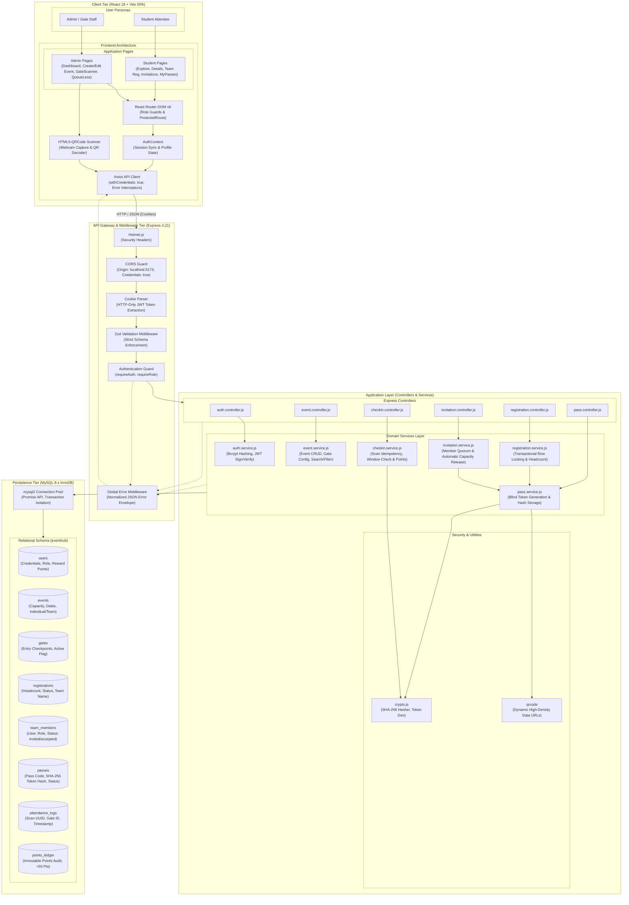
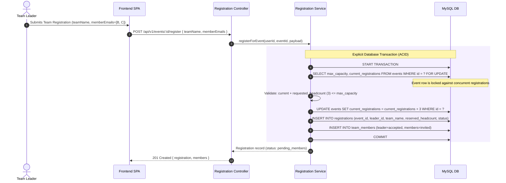
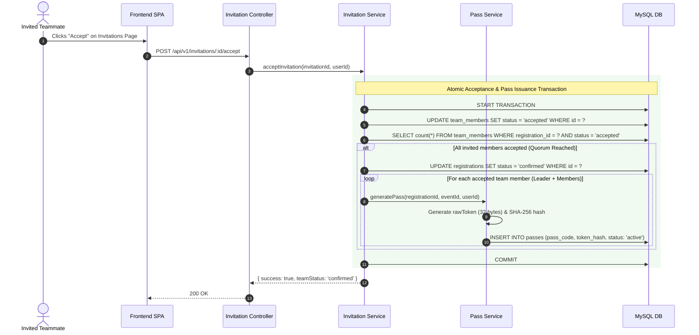
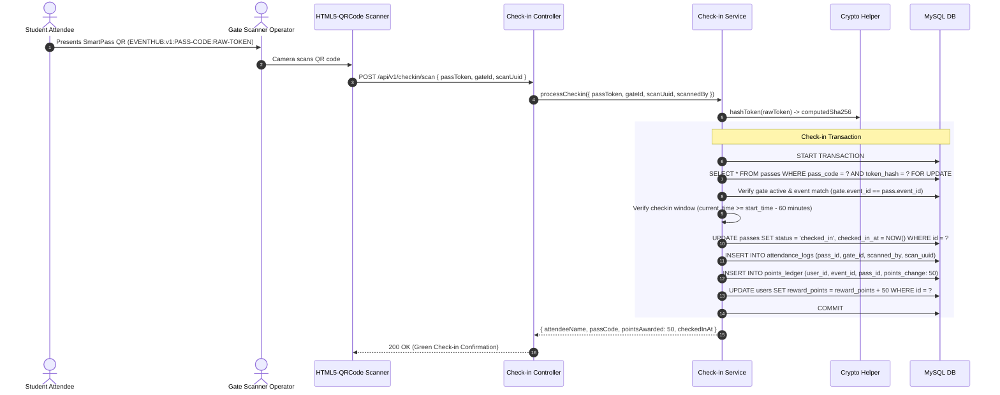

# EventHub System Architecture & Data Flow

> High-resolution architectural diagram and component data-flow walkthrough for the EventHub campus event management platform.

---

## 1. Complete System Architecture Diagram



---

## 2. Core Architectural Principles

### 2.1 Separation of Concerns
1. **Presentation (Client)**: React 18 Single-Page Application (SPA) driven by component modularity, stateful contexts (`AuthContext`), and role-based route guards (`ProtectedRoute`).
2. **Gateway (Server)**: Express 4.21 middleware chain providing input sanitation, cryptographic token extraction, role validation, and structured error responses.
3. **Domain Logic (Services)**: Autonomous business service layer completely decoupled from HTTP request/response objects, ensuring testability and transactional integrity.
4. **Relational Consistency (Database)**: MySQL 8 InnoDB enforcing ACID guarantees, foreign keys, unique constraints, and row-level locks.

### 2.2 Defense in Depth Security
- **No Stored Plaintext Credentials**: Passwords hashed with bcrypt (cost factor 12).
- **No Stored QR Secrets**: The raw QR secret token is generated cryptographically, delivered to the student, and immediately hashed using SHA-256. The database stores only the hash digest. Even a full database dump cannot forge valid check-in QR codes.
- **XSS-Resistant Sessions**: JWT tokens are placed strictly in HTTP-only, SameSite cookies. JavaScript running on the frontend cannot inspect or modify session credentials.
- **Replay Attack Defense**: Scanning uses client-generated `scanUuid` tokens. Duplicate scans fail gracefully without altering pass state or awarding multiple reward points.

---

## 3. Data Flow Walkthroughs

### 3.1 Authentication & Session Lifecycle

```mermaid
sequenceDiagram
    autonumber
    actor User as Student / Admin
    participant Client as Frontend SPA
    participant AuthCtrl as Auth Controller
    participant AuthSvc as Auth Service
    participant DB as MySQL DB

    User->>Client: Enters credentials (Email & Password)
    Client->>AuthCtrl: POST /api/v1/auth/login { email, password }
    AuthCtrl->>AuthSvc: loginUser(email, password)
    AuthSvc->>DB: SELECT * FROM users WHERE email = ?
    DB-->>AuthSvc: User record with password_hash
    AuthSvc->>AuthSvc: bcrypt.compare(password, password_hash)
    AuthSvc->>AuthSvc: jwt.sign({ id, email, role }, JWT_SECRET, { expiresIn: 86400 })
    AuthSvc-->>AuthCtrl: { user, token }
    AuthCtrl-->>Client: Set-Cookie: token=...; HttpOnly; SameSite=Lax; Max-Age=86400
    Client->>AuthCtrl: GET /api/v1/auth/me (Cookie automatically attached)
    AuthCtrl-->>Client: 200 OK { user: { id, fullName, role, rewardPoints } }
```

### 3.2 Concurrency-Safe Headcount Registration



### 3.3 Team Invitation & Automatic Quorum Release



If an invited member clicks **Decline**, the service checks if the remaining team size drops below `min_team_size`. If quorum is lost:
1. Team registration is updated to `cancelled`.
2. All team member records are marked `declined`.
3. The reserved headcount is atomically decremented on the event row: `UPDATE events SET current_registrations = current_registrations - reserved_headcount WHERE id = ?`.
4. The capacity is immediately freed for other students.

### 3.4 Cryptographic SmartPass Verification & Gate Check-In



---

## 4. Key Component Directory Mapping

| Layer | Files | Responsibilities |
|---|---|---|
| **Routing & Guards** | `client/src/App.jsx`<br>`client/src/components/common/ProtectedRoute.jsx` | Authenticated and role-based client routing |
| **HTTP Interceptor** | `client/src/api/client.js` | Base Axios client, cookie credentials, error payload unwrapping |
| **Scanner Interface** | `client/src/pages/admin/GateScannerPage.jsx` | `Html5QrcodeScanner` lifecycle, scan deduplication, audio/visual cues |
| **API Entrypoint** | `server/src/server.js`<br>`server/src/app.js` | Express middleware mount, port listener, graceful shutdown |
| **Auth Middleware** | `server/src/middleware/auth.middleware.js` | JWT cookie validation, user attachment (`req.user`), role enforcement |
| **Validation Layer** | `server/src/validators/*.validator.js`<br>`server/src/middleware/validate.middleware.js` | Zod schema validation for request params and bodies |
| **Service Layer** | `server/src/services/*.service.js` | Domain business logic, database transactions, row-level locks |
| **Crypto Utility** | `server/src/utils/crypto.js` | `crypto.randomBytes`, `crypto.createHash('sha256')` |
| **Database Pool** | `server/src/config/db.js` | `mysql2/promise` connection pool with query timeout and error logging |
