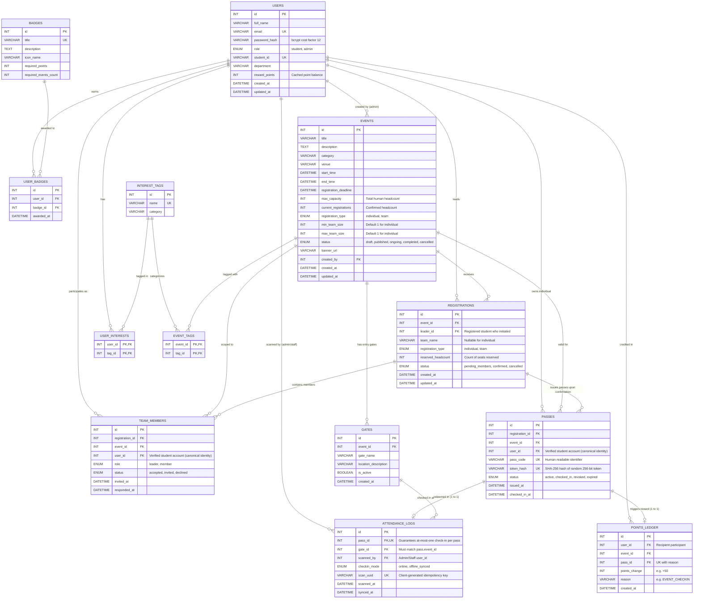

# EventHub — Version 2.2 (Implementation Ready)
## Technical Architecture Document
**Intelligent Campus Event Management Ecosystem**

---

## 1. System Overview & Deployment Topology

EventHub is an integrated, student-first platform designed to orchestrate college event operations: discovery, individual and multi-member team registration, capacity preservation, cryptographic QR check-in (SmartPass), gate throughput tracking (QueueLess), student achievement portfolios (CampusPass), explainable recommendations (EventIQ), and operational analytics (Event Health Monitor).

### Target Production Topology
- **Frontend Client**: Hosted on **Vercel** (React 18 + Vite + Tailwind CSS + Lucide React + Recharts).
- **Backend API Gateway**: Hosted on **Railway** (Node.js 20+ LTS + Express.js layered architecture).
- **Managed Database**: **MySQL 8.x** (Railway Managed MySQL or PlanetScale/Aiven MySQL-compatible service) with InnoDB storage engine, foreign key constraints, and row-level locking.
- **Communication Protocol**: HTTPS with JSON payloads, HTTP-only SameSite session cookies, and double-submit CSRF headers.

```
┌────────────────────────────────────────────────────────────────────────┐
│                   CLIENT TIER (Vercel Production)                      │
│   React 18 SPA (Vite) + Tailwind CSS + Lucide React + Recharts         │
│   - Axios withCredentials: true                                        │
│   - Double-Submit CSRF Request Interceptor (X-CSRF-Token)              │
│   - Browser IndexedDB (Offline Manifest Storage & Scan Queue)          │
│   - Web Crypto API (Ed25519 Public Key Verification)                   │
└───────────────────────────────────┬────────────────────────────────────┘
                                    │ HTTPS + Cookies (cross-site / sub-domain)
                                    ▼
┌────────────────────────────────────────────────────────────────────────┐
│                   SERVER TIER (Railway Production)                     │
│   Express.js RESTful API Gateway (Layered Controller-Service Model)    │
│   - Helmet Security Headers & Strict CORS Whitelist                    │
│   - Double-Submit CSRF Validation Middleware                           │
│   - JWT Cookie Session Verification (req.cookies.access_token)         │
│   - Role-Based Access Control (RBAC: student, admin)                   │
│   - Zod Input Validation & Sanitization                                │
│   - Ed25519 Asymmetric Cryptographic Signer (Private Key Server-Only) │
└───────────────────────────────────┬────────────────────────────────────┘
                                    │ mysql2/promise Connection Pool
                                    ▼
┌────────────────────────────────────────────────────────────────────────┐
│                   DATABASE TIER (Managed MySQL 8.x)                    │
│   InnoDB Engine with ACID Transactions & Strict Referential Integrity │
│   - Pessimistic Row-Level Locks (SELECT ... FOR UPDATE)                │
│   - Compound Unique Constraints (Zero Overbooking, Single Reward)      │
│   - Append-Only Auditable Points Ledger                                │
└────────────────────────────────────────────────────────────────────────┘
```

---

## 2. Directory & Folder Layout

The project structure enforces clean boundaries between layers, maintainability, and zero circular dependencies.

```
EventHub/
├── docs/                             # Authoritative Architecture & Specification
│   ├── architecture.md               # Version 2.2 System Architecture (This file)
│   ├── api-design.md                 # Version 2.2 Complete API Contracts & Schemas
│   └── development-roadmap.md        # Version 2.2 Milestones & 20-Scenario QA Matrix
│
├── database/                         # Database DDL, Seeds, and Migrations
│   ├── schema.sql                    # Production MySQL 8.x DDL with indexes & constraints
│   ├── seeds.sql                     # Seed data with bcrypt (cost factor 12) passwords
│   └── reset.sql                     # Idempotent development environment reset script
│
├── server/                           # Backend Application Source
│   ├── src/
│   │   ├── config/                   # Environment validation & DB connection pool
│   │   │   ├── db.js                 # mysql2/promise pool with keepAlive & error handling
│   │   │   └── env.js                # Zod runtime schema validation for process.env
│   │   ├── controllers/              # HTTP Request / Response Handlers
│   │   │   ├── auth.controller.js
│   │   │   ├── event.controller.js
│   │   │   ├── gate.controller.js    # Gate management (CRUD & activation)
│   │   │   ├── registration.controller.js
│   │   │   ├── invitation.controller.js # Team invitation accept / decline
│   │   │   ├── checkin.controller.js
│   │   │   ├── queueless.controller.js
│   │   │   ├── recommendation.controller.js
│   │   │   ├── campuspass.controller.js
│   │   │   └── analytics.controller.js
│   │   ├── services/                 # Transactional Business Logic
│   │   │   ├── auth.service.js       # Password hashing (bcrypt-12), JWT generation
│   │   │   ├── event.service.js      # Event lifecycle & gate management
│   │   │   ├── registration.service.js # Headcount locking, team invites & pass creation
│   │   │   ├── qr.service.js         # crypto.randomBytes(32), SHA-256 blind hashing
│   │   │   ├── checkin.service.js    # Canonical atomic check-in transaction
│   │   │   ├── queueless.service.js  # 10-minute sliding window scan throughput
│   │   │   ├── eventiq.service.js    # Rule-based explainable recommendation scoring
│   │   │   ├── campuspass.service.js # Points ledger and badge evaluation engine
│   │   │   └── offline.service.js    # Ed25519 canonical manifest signing & sync validation
│   │   ├── middlewares/              # Security and Operational Middlewares
│   │   │   ├── auth.middleware.js    # Cookie JWT extractor & RBAC guard
│   │   │   ├── csrf.middleware.js    # Double-submit CSRF token validator
│   │   │   ├── validate.middleware.js# Generic Zod validation wrapper
│   │   │   ├── rateLimit.middleware.js# Brute-force & scanning rate limiters
│   │   │   └── error.middleware.js   # Centralized error handler with sanitization
│   │   ├── validators/               # Zod Schemas for Request Payloads
│   │   │   ├── auth.validator.js
│   │   │   ├── event.validator.js
│   │   │   ├── gate.validator.js
│   │   │   ├── registration.validator.js
│   │   │   └── checkin.validator.js
│   │   ├── utils/                    # Shared Helper Functions
│   │   │   ├── crypto.js             # Cryptographic helpers (Ed25519, SHA-256, tokens)
│   │   │   ├── apiResponse.js        # Standardized { success, data, error } envelopes
│   │   │   └── logger.js             # Structured console logger
│   │   ├── app.js                    # Express app instantiation & middleware pipeline
│   │   └── server.js                 # HTTP listener & process signal traps
│   ├── tests/                        # Automated Test Suites (Jest/Supertest)
│   │   ├── auth.test.js              # Registration, login, cookie & CSRF tests
│   │   ├── registration.test.js      # Headcount concurrency & duplicate team prevention
│   │   ├── checkin.test.js           # Atomic check-in transaction, gate mismatch & duplicate detection
│   │   ├── offline.test.js           # Ed25519 signature & sync conflict tests
│   │   └── ledger.test.js            # Points ledger idempotency & badge tests
│   ├── package.json
│   └── .env.example
│
├── client/                           # Frontend React SPA
│   ├── public/
│   │   └── favicon.ico
│   ├── src/
│   │   ├── components/               # Atomic & Shared Components
│   │   │   ├── common/               # Button, Input, Modal, Badge, Toast
│   │   │   ├── layout/               # Navbar, Sidebar, ProtectedRoute
│   │   │   ├── events/               # EventCard, EventGrid, RegistrationModal
│   │   │   ├── qr/                   # SmartPassCard, QrScanner (html5-qrcode)
│   │   │   └── analytics/            # ThroughputIndicator, HealthCharts (Recharts)
│   │   ├── context/
│   │   │   ├── AuthContext.jsx       # User session state (fetched from /api/v1/auth/me)
│   │   │   └── ToastContext.jsx      # Global notification banners
│   │   ├── db/
│   │   │   └── indexedDB.js          # IndexedDB wrapper for offline manifests & scans
│   │   ├── hooks/
│   │   │   ├── useAuth.js
│   │   │   ├── useFetch.js
│   │   │   └── useDebounce.js
│   │   ├── pages/
│   │   │   ├── auth/                 # LoginPage, RegisterPage
│   │   │   ├── student/              # BrowseEventsPage, EventDetailsPage, MyPassesPage, CampusPassPage
│   │   │   └── admin/                # AdminDashboardPage, ManageEventsPage, GateScannerPage, HealthMonitorPage
│   │   ├── services/
│   │   │   ├── api.js                # Axios client with credentials & CSRF interceptor
│   │   │   ├── auth.service.js
│   │   │   ├── event.service.js
│   │   │   ├── registration.service.js
│   │   │   └── checkin.service.js
│   │   ├── utils/
│   │   │   ├── ed25519Verifier.js    # Web Crypto API Ed25519 manifest verification
│   │   │   └── constants.js
│   │   ├── App.jsx                   # Route declarations
│   │   ├── main.jsx                  # React DOM mount point
│   │   └── index.css                 # Tailwind CSS styles
│   ├── index.html
│   ├── vite.config.js
│   ├── tailwind.config.js
│   └── package.json
│
└── README.md
```

---

## 3. Database Architecture & Complete ER Model

The relational model enforces multi-entity referential integrity, deletion restrictions on audited data, and compound unique constraints to physically prevent double registrations, duplicate event participation, duplicate attendance logs, and duplicate reward issuance.

### 3.1 Mermaid Entity-Relationship Diagram



### 3.2 Canonical Identity, Relational Integrity & Protection of Historical Data

#### 1. Canonical Student Identity Standard
- The canonical representation of any student is their foreign key `users.id` (`user_id`).
- All pass ownership, team invitations, and reward ledger entries reference `user_id` directly.
- `student_id` is an institutional identification string stored strictly on the `users` table (`users.student_id`) and is resolved via `JOIN users u ON ...` rather than redundantly duplicated across relational tables.

#### 2. Constraints and Ownership Rules
- **Universal Duplicate Event Participation Constraint**:
  `UNIQUE KEY uq_event_user_participation (event_id, user_id)` on `TEAM_MEMBERS`.
  *Explanation*: A student (`user_id`) can be invited to, lead, or participate in at most **one** registration per event.
- **Single Pass per Student Constraint**:
  `UNIQUE KEY uq_event_user_pass (event_id, user_id)` on `PASSES`.
  *Explanation*: Guarantees that at the database level, no user can ever hold more than one pass for any single event.
- **At-Most-One Attendance Constraint**:
  `UNIQUE KEY uq_attendance_pass (pass_id)` on `ATTENDANCE_LOGS`.
  *Clarification*: A unique constraint guarantees **at most one** attendance row for a pass, preventing duplicate check-ins. Attendance records are inserted **only after successful pass validation and redemption**. The ACID transaction guarantees **exactly one** attendance record upon successful check-in.
- **Idempotent Scan Synchronization**:
  `UNIQUE KEY uq_attendance_scan_uuid (scan_uuid)` on `ATTENDANCE_LOGS`.
  *Explanation*: Guarantees that if a client or offline sync retry retransmits the same `scan_uuid`, duplicate attendance entries are rejected.
- **Duplicate Reward Prevention**:
  `UNIQUE KEY uq_pass_reason (pass_id, reason)` on `POINTS_LEDGER`.
  *Explanation*: Guarantees attendance points (`EVENT_CHECKIN`) can only be credited once per verified pass.
- **Badge Uniqueness**:
  `UNIQUE KEY uq_user_badge (user_id, badge_id)` on `USER_BADGES`.

#### 3. Protection of Historical Records
- **Foreign Key Deletion Rules**:
  - `ON DELETE RESTRICT` is applied to `EVENTS(created_by)`, `REGISTRATIONS(event_id)`, `REGISTRATIONS(leader_id)`, `PASSES(registration_id)`, `PASSES(user_id)`, `ATTENDANCE_LOGS(pass_id)`, `POINTS_LEDGER(pass_id)`.
  - Attempting to delete an event, user, registration, or pass that has associated historical attendance or ledger records is rejected by the MySQL engine.
- **Immutability of Audit Ledgers**:
  - `ATTENDANCE_LOGS` and `POINTS_LEDGER` are strictly append-only.
  - The API exposes zero `PUT`, `PATCH`, or `DELETE` endpoints for attendance or ledger records.
  - Production database user privileges can omit `DELETE` grants on audit tables.

---

## 4. Subsystem Specifications

### 4.1 Authentication, Cookies & CSRF Protection

#### 1. Server-Side Role Enforcement
- Public registration (`POST /api/v1/auth/register`) strictly ignores any `role` attribute in the request body. The server unconditionally assigns `role = 'student'`.
- Administrator accounts are never created through public registration. They are provisioned through seed scripts (`database/seeds.sql`) or internal administrative scripts using secure environment variables.
- Every protected endpoint enforces server-side authentication, role authorization (`req.user.role === 'admin'`), and resource ownership (`pass.user_id === req.user.id`).

#### 2. Cookie Configuration (Development vs Production)
Session tokens are stored exclusively in HTTP-only cookies.

| Cookie Option | Development (`localhost`) | Production (`Vercel` $\leftrightarrow$ `Railway`) | Security Purpose |
| :--- | :--- | :--- | :--- |
| `HttpOnly` | `true` | `true` | Inaccessible to JavaScript (`document.cookie`). Eliminates XSS token theft. |
| `Secure` | `false` (or `true` if HTTPS) | `true` | Transmitted strictly over TLS/HTTPS connections. |
| `SameSite` | `'lax'` | `'lax'` (same domain) / `'none'` (cross-domain) | Defends against cross-site request forgery while permitting authorized requests. |
| `Path` | `'/'` | `'/'` | Available across all API endpoints. |
| `Max-Age` | `86400` (24h) | `86400` (24h) | Bounds total token lifespan. |

#### 3. CSRF Protection & Bootstrap Procedure
- **Token Generation**: Generated using `crypto.randomBytes(32).toString('hex')`.
- **Bootstrap Procedure**:
  1. The client issues a `GET /api/v1/auth/csrf` request upon loading or receives `XSRF-TOKEN` cookie upon login/registration.
  2. The server sets a readable cookie `XSRF-TOKEN` (`HttpOnly: false`, `SameSite: 'lax'`, `Secure: true` in production).
  3. The Axios interceptor extracts the cookie and attaches it to the `X-CSRF-Token` HTTP header on all mutating methods: `POST`, `PUT`, `PATCH`, `DELETE`.
  4. Middleware verifies that `req.headers['x-csrf-token'] === req.cookies['XSRF-TOKEN']`. If invalid or absent, the request is rejected with `403 Forbidden`. Safe methods (`GET`, `HEAD`, `OPTIONS`) are exempt.

#### 4. Logout Limitations of Stateless JWTs
- Calling `POST /api/v1/auth/logout` clears the `access_token` and `XSRF-TOKEN` cookies in the client browser, terminating the active user session.
- *Architectural Limitation*: Because JWTs are stateless, if an extracted token was maliciously intercepted prior to logout, it remains cryptographically valid until its 24-hour expiration. For a college campus deployment, clearing HTTP-only cookies combined with strict 24-hour expiration represents a pragmatic and standard architecture.

---

### 4.2 Individual and Team Registration Lifecycle & Pass Isolation

```
[Team Leader]                    [EventHub Server]                 [Invited Student]
     │                                   │                                 │
     │ 1. POST /events/:id/register      │                                 │
     │    (teamName, memberEmails)       │                                 │
     │──────────────────────────────────>│                                 │
     │                                   │                                 │
     │                                   │- Lock event row (FOR UPDATE)    │
     │                                   │- Verify student accounts exist  │
     │                                   │- Check duplicate participation  │
     │                                   │- Reserve headcount capacity     │
     │                                   │- Insert REGISTRATION (pending)  │
     │                                   │- Insert TEAM_MEMBERS (invited)  │
     │                                   │                                 │
     │ 2. Return 201 Created             │                                 │
     │    (status: pending_members)      │                                 │
     │<──────────────────────────────────│                                 │
     │                                   │                                 │
     │                                   │ 3. View invitation in portal    │
     │                                   │<────────────────────────────────│
     │                                   │                                 │
     │                                   │ 4. POST /invitations/:id/accept │
     │                                   │<────────────────────────────────│
     │                                   │                                 │
     │                                   │- Update status to 'accepted'    │
     │                                   │- If all members accepted:       │
     │                                   │    REGISTRATION -> 'confirmed'  │
     │                                   │    GENERATE INDIVIDUAL PASSES   │
     │                                   │                                 │
     │ 5. GET /passes/my-passes          │ 6. GET /passes/my-passes        │
     │    (Returns LEADER pass only)     │    (Returns MEMBER pass only)   │
     │──────────────────────────────────>│<────────────────────────────────│
```

#### Detailed Lifecycle Rules:
1. **Verified Accounts Required**: The leader submits invitee emails. The backend verifies that every email corresponds to an active student account in `users`. Unverified emails are rejected with `400 Bad Request`.
2. **Headcount Capacity Reservation**: The event's `current_registrations` counter is incremented by `reserved_headcount` inside a `SELECT ... FOR UPDATE` transaction.
3. **Pending State**: Registration is created with status `'pending_members'`. No QR passes are issued.
4. **Invitation Acceptance**: Each invitee reviews the invitation (`GET /api/v1/invitations`) and calls `POST /api/v1/invitations/:id/accept`.
5. **Confirmation & Pass Generation**:
   - When all required members accept, registration transitions to `'confirmed'`.
   - The system creates individual rows in `passes` for each member (`user_id = member.user_id`).
6. **Pass Isolation & Zero Token Sharing**:
   - When a student accepts an invitation, the response contains **only their own pass**.
   - `GET /api/v1/passes/my-passes` returns passes where `user_id = req.user.id`.
   - Team leaders **never receive or view other members' raw QR tokens**.
7. **Handling Incomplete, Declined, or Expired Registrations**:
   - Invitations carry an expiration timestamp: $\text{expiresAt} = \min(\text{createdAt} + 24\text{ hours}, \text{registrationDeadline})$.
   - If an invitee declines or fails to accept before expiration:
     - The leader can reinvite a replacement student before `registration_deadline`.
     - If the team fails to achieve `min_team_size` by `registration_deadline`, the registration transitions to `'cancelled'`, and the reserved headcount is released:
       $$\text{current\_registrations} = \text{current\_registrations} - \text{reserved\_headcount}$$

---

### 4.3 SmartPass Cryptographic Blind Verification

#### 1. Generation & Storage
- **Entropy**: Raw tokens are generated using a cryptographically secure pseudorandom number generator:
  ```javascript
  const rawToken = crypto.randomBytes(32).toString('hex'); // 64 hexadecimal characters
  ```
- **Blind Hash Storage**: The database stores only the SHA-256 hash:
  ```javascript
  const tokenHash = crypto.createHash('sha256').update(rawToken).digest('hex'); // 64 hexadecimal characters
  ```
- **Zero Token Leakage**: The database never stores `rawToken`. Pass retrieval APIs return `passCode` and a temporary rendered QR image, but `token_hash` is never exposed.

#### 2. Payload Format
The QR image encodes:
$$\text{QR Payload} = \text{"EVPASS:v1:"} + \text{passCode} + ":" + \text{rawToken}$$

---

### 4.4 Canonical Atomic Check-In Transaction

To guarantee that attendance, pass redemption, and reward points remain 100% consistent, check-in operations run inside a **single ACID transaction**:

```sql
START TRANSACTION;

-- Step 1: Validate pass existence and retrieve event/user associations
SELECT p.id, p.event_id, p.user_id, p.status, p.pass_code, e.status AS event_status, e.start_time, e.end_time
FROM passes p
JOIN events e ON p.event_id = e.id
WHERE p.token_hash = ? FOR UPDATE;
-- IF pass not found: ROLLBACK; RETURN 404 "Invalid pass token";

-- Step 2: Validate expiration, revocation, and check-in time window
-- IF p.status = 'checked_in' THEN ROLLBACK; RETURN 409 "Duplicate Pass: Already checked in";
-- IF p.status = 'revoked' THEN ROLLBACK; RETURN 400 "Pass has been revoked by administration";
-- IF p.status = 'expired' OR e.end_time < NOW() THEN ROLLBACK; RETURN 400 "Event has concluded / Pass expired";
-- IF e.status = 'cancelled' THEN ROLLBACK; RETURN 400 "Event was cancelled";
-- IF NOW() < DATE_SUB(e.start_time, INTERVAL 60 MINUTE) THEN ROLLBACK; RETURN 400 "Check-in window not yet open";

-- Step 3: Validate gate permissions and event match
SELECT id, event_id, is_active FROM gates WHERE id = ? FOR UPDATE;
-- IF gate not found OR gate.is_active = FALSE THEN ROLLBACK; RETURN 400 "Gate is inactive";
-- IF gate.event_id != p.event_id THEN ROLLBACK; RETURN 400 "Gate mismatch: Gate belongs to different event";

-- Step 4 & 5: Conditional pass redemption
UPDATE passes 
SET status = 'checked_in', checked_in_at = NOW() 
WHERE id = p.id AND status = 'active';
-- IF affectedRows == 0 THEN ROLLBACK; RETURN 409 "Concurrent check-in conflict";

-- Step 6: Insert attendance record (Guaranteed at-most-one by UNIQUE KEY (pass_id))
INSERT INTO attendance_logs (pass_id, gate_id, scanned_by, checkin_mode, scan_uuid, scanned_at)
VALUES (p.id, gate_id, admin_user_id, 'online', client_scan_uuid, NOW());

-- Step 7: Insert reward points ledger record (Guaranteed at-most-one by UNIQUE KEY (pass_id, reason))
INSERT INTO points_ledger (user_id, event_id, pass_id, points_change, reason, created_at)
VALUES (p.user_id, p.event_id, p.id, 50, 'EVENT_CHECKIN', NOW());

-- Step 8: Update participant cached reward balance
UPDATE users SET reward_points = reward_points + 50 WHERE id = p.user_id;

-- Step 9: Commit transaction
COMMIT;
```

#### Scan UUID Idempotency:
- The client scanner generates a UUIDv4 `scanUuid` for each QR scan.
- If network jitter causes the client to retransmit the scan, the `UNIQUE KEY (scan_uuid)` constraint on `attendance_logs` guarantees idempotency.

---

### 4.5 QueueLess Gate Throughput Architecture & Honest Limitations

#### 1. Throughput Calculation:
QueueLess computes gate processing rate over a 10-minute sliding window:
$$\text{ScanThroughput}_g = \frac{\text{Check-ins at Gate } g \text{ in last } 10 \text{ minutes}}{10} \quad (\text{scans per minute})$$

#### 2. Gate Activity Indicators:
- $\text{Throughput} < 3 \text{ scans/min}$: `Low Activity (Fast Entry)`
- $3 \le \text{Throughput} \le 8 \text{ scans/min}$: `Steady Flow`
- $\text{Throughput} > 8 \text{ scans/min}$: `High Scan Velocity`

#### 3. Honest Architectural Limitation:
EventHub does not possess external cameras, turnstiles, or LiDAR sensors.
- The system **cannot and does not measure physical line length**.
- If 200 students are physically waiting outside a gate that is stalled or not scanning, the scan rate will read low.
- The UI features a mandatory disclaimer:
  > *"Notice: Gate activity indicators and recommendations are calculated strictly from check-in scan throughput at each terminal over the past 10 minutes. They do not measure physical queue lengths outside the venue."*

---

### 4.6 EventIQ Explainable Recommendation Scoring

EventIQ uses a transparent, rule-based scoring formula:
$$\text{Score}(u, e) = 40 \cdot S_{\text{interests}}(u, e) + 25 \cdot S_{\text{dept}}(u, e) + 20 \cdot S_{\text{history}}(u, e) + 15 \cdot S_{\text{urgency}}(e)$$

Where:
- $S_{\text{interests}} = \frac{|\text{EventTags}(e) \cap \text{UserInterests}(u)|}{|\text{EventTags}(e)|} \in [0, 1]$
- $S_{\text{dept}} = 1.0$ if user's academic department matches event category, else $0.0$.
- $S_{\text{history}} = 1.0$ if user previously attended an event in the same category, else $0.0$.
- $S_{\text{urgency}} = 1.0$ if registration closes in $< 48$ hours and capacity remains, else $0.0$.

*Architecture Note*: EventHub explicitly documents this as an explainable heuristic scoring algorithm. No deep learning or neural network intelligence is claimed.

---

### 4.7 Asymmetric Offline Check-in (Ed25519 & IndexedDB)

#### 1. Cryptographic Key Management
- **Ed25519 Private Key**: Stored exclusively on the server (`process.env.ED25519_PRIVATE_KEY`). Never exposed to clients or APIs.
- **Ed25519 Public Key**: Shipped to the frontend via `/api/v1/checkin/public-key` and cached.

#### 2. Canonical Manifest Format & Signing
Before the event, the server generates a canonical manifest payload:
```json
{
  "manifestVersion": "1.0",
  "eventId": 14,
  "eventTitle": "HackCampus 2026",
  "generatedAt": "2026-11-28T08:00:00.000Z",
  "expiresAt": "2026-11-29T22:00:00.000Z",
  "passes": [
    {
      "passCode": "PASS-2026-8941",
      "tokenHash": "e3b0c44298fc1c149afbf4c8996fb92427ae41e4649b934ca495991b7852b855",
      "studentName": "Alex Chen",
      "studentId": "CS-2024-0042"
    }
  ]
}
```
The server signs the canonical stringified JSON using Ed25519:
$$\text{ed25519Signature} = \text{crypto.sign}(null, \text{Buffer.from}(\text{canonicalJson}), \text{ed25519PrivateKey}).\text{toString}('base64')$$

#### 3. Client Verification & IndexedDB Security
- The browser validates the signature using the Web Crypto API (`window.crypto.subtle.verify`) before saving to **IndexedDB** (`eventhub_offline_db`). If the signature is invalid, the manifest is rejected.
- **Data Protection & Automatic Cleanup**: Cached manifests in IndexedDB contain only essential verification data (`passCode`, `tokenHash`, `studentName`, `studentId`). Manifests are automatically deleted from IndexedDB when `expiresAt` is reached or when the admin clears the scanner cache.

#### 4. Idempotent Synchronization & Cross-Device Limitation
- Every offline scan logs an entry in IndexedDB with a unique `scanUuid` (UUIDv4).
- When internet connectivity returns, the client transmits `POST /api/v1/checkin/sync-offline`.
- The server processes each scan inside an individual transaction.
- **Documented Limitation**: If Gate 1 and Gate 2 are both disconnected from the network, a student could present the same pass at Gate 1 at 10:00 AM and at Gate 2 at 10:02 AM. Both offline devices will accept the pass locally. Upon server synchronization, the first processed scan commits successfully, while the second is rejected and flagged as a **Sync Security Anomaly** (`ANOMALY_DUPLICATE_OFFLINE_SCAN`) for administrative review. Real-time cross-device duplicate prevention across disconnected devices is physically impossible without inter-device communication.
